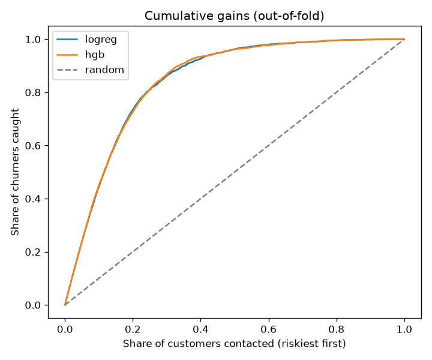
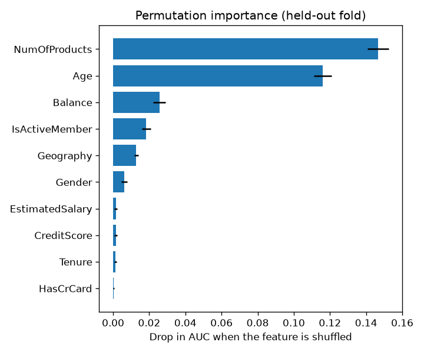
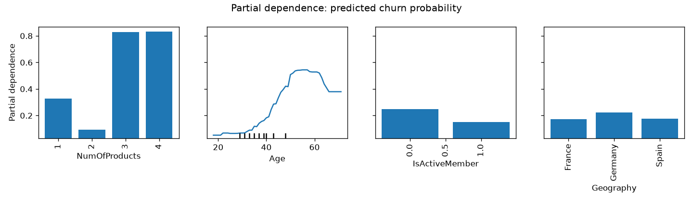

# Bank Churn Prediction

[](https://github.com/Talibdev27/bank-churn-prediction/actions/workflows/ci.yml)

Predicting which bank customers will leave, using data from the Kaggle competition
[Binary Classification with a Bank Churn Dataset](https://www.kaggle.com/competitions/binaryclassificationwithabankchurndataset).
The competition scores models by ROC-AUC.

**Headline:** if the bank contacts the riskiest 20% of customers, it reaches **73% of the customers who will churn**.
That is 3.6× better than picking customers at random. The best model scores 0.930 cross-validated AUC.

## Results

5-fold stratified cross-validation, ROC-AUC:

| Model | Features | AUC |
|---|---|---|
| Logistic regression (baseline) | raw columns | 0.8829 |
| Logistic regression | engineered features + one-hot `NumOfProducts` | 0.9285 ± 0.0032 |
| **HistGradientBoosting** | engineered features, native categoricals | **0.9298 ± 0.0020** |

The engineered features close most of the gap between the linear model and boosting.
For boosting they barely matter, because trees find the same splits on their own.

### Business view

The table and chart use out-of-fold predictions: each customer is scored by a model that never saw them during training.

| Riskiest customers contacted | Churners reached | Precision | Lift vs random |
|---|---|---|---|
| 10% | 45% | 89% | 4.5× |
| 20% | 73% | 72% | 3.6× |
| 30% | 87% | 57% | 2.9× |



Where to set the cutoff is a business decision. A real bank would plug in its own cost per contact and the value
of a retained customer to choose how many customers to contact.

### Why customers churn

Permutation importance and partial dependence, both computed on a held-out cross-validation fold:





- **Number of products** matters most, and its effect is U-shaped. Customers with 2 products are by far the safest,
  and customers with 3 or more almost always leave.
- **Age** is next. Risk climbs from the mid-30s and peaks around 50–60.
- **Inactive members** churn more. Germany's raw 41% churn rate shrinks to a small bump once age, balance and number
  of products are accounted for, so the "Germany effect" largely comes from who the German customers are.
- Credit score, tenure, salary and card ownership add almost nothing.

### No leakage through `CustomerId`

`CustomerId` repeats (6,306 unique ids across 15,000 rows), but 98% of repeated ids have different ages and
99.9% have different surnames. The id is an artifact of the synthetic data, not a real repeat customer.
Cross-validation that keeps each id in a single fold gives the same AUC, so plain stratified CV is safe.

## Project layout

```
src/churn/
  data.py       # download/load the Kaggle data
  features.py   # feature engineering (add_features)
  model.py      # logistic regression and HistGB pipelines
  train.py      # cross-validate, pick the best model, write metrics + submission
  report.py     # gains, permutation importance and partial dependence charts
notebooks/
  churn.ipynb   # EDA and the modeling story; imports from churn.*
reports/        # metrics.json, gains.json and charts (committed)
tests/          # pytest suite on synthetic data, no network needed
```

All encoding happens inside scikit-learn pipelines. Each pipeline takes the raw columns, engineers its features and
fits its encoders on the training folds only. Train and test always end up with the same columns, and a category
the model never saw doesn't break it.

## How to run

Requires [uv](https://docs.astral.sh/uv/). Put your Kaggle API token in `~/.kaggle/kaggle.json` and accept the
competition rules on Kaggle.

```bash
uv sync
uv run python -m churn.train    # CV both models, write reports/metrics.json and submission.csv
uv run python -m churn.report   # draw the charts in reports/
uv run pytest                   # tests
```

Options: `python -m churn.train --model hgb --folds 10 --data-dir path/to/csvs`. Run with `--help` for the full list.

Without uv, run `pip install -e .` inside a Python 3.12+ virtual environment.

## Next steps

- Tune HistGB (`learning_rate`, `max_leaf_nodes`, `l2_regularization`)
- Try LightGBM and CatBoost, then blend models
- SHAP values for per-customer explanations
- Compare CV scores against the public leaderboard

## License

[MIT](LICENSE)
